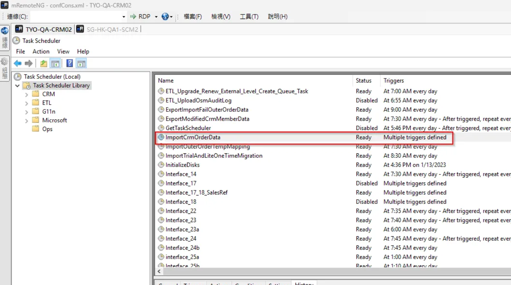
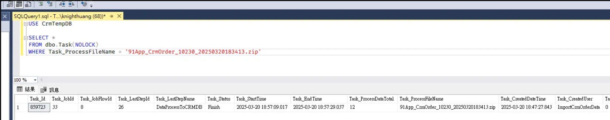
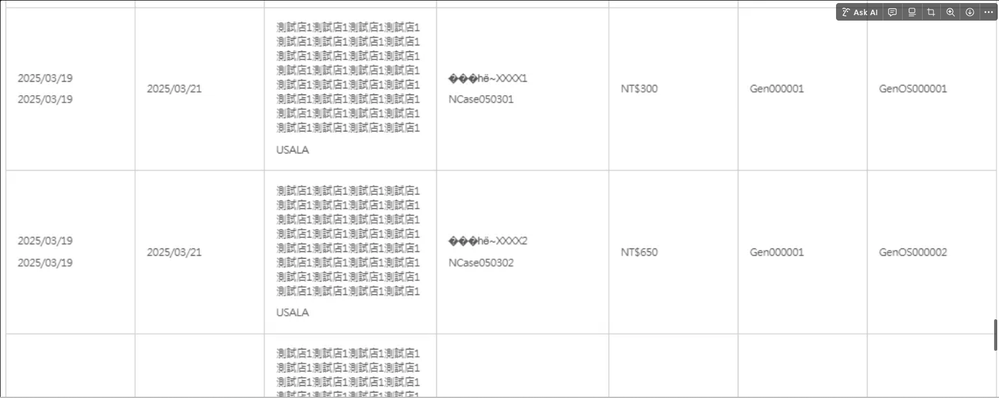
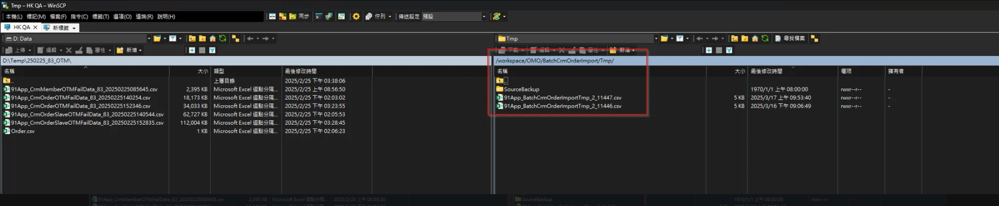

# BatchCrmOrderImport — 其他交易資料匯入

## 基本資訊

| 項目 | 值 |
|------|-----|
| 批次類型（TypeDef） | `BatchCrmOrderImport` |
| NMQ Job Name | `BatchCrmOrderImportTask` |
| BatchUploadData_TypeDef | `BatchCrmOrderImport` |
| ETL 排程 | `ImportCrmOrderData`（FTP產品化串接-每日線下訂單匯入） |
| ShopEtlFlowId | 48 |

<br>

---

## 流程概覽

```bash
1. 使用者上傳 CSV 至 OSM
2. 建立 BatchUpload NMQ Task（BatchCrmOrderImportTask）
3. NMQ 將資料儲存為 CSV 暫存檔並上傳至 SFTP
4. ETL 排程（cron: 4-59/10 * * * *）掃描 SFTP，將檔案搬移並處理
5. 處理完成後 BatchUploadData_StatusDef 更新
```

<br>

---

## 暫存路徑

| 環境 | 路徑 |
|------|------|
| SFTP 暫存 | `sftp://.../workspace/OMO/BatchCrmOrderImport/Tmp/` |
| 本地暫存 | `\\{Filer}\Storage\Tmp\BatchCrmOrderImport\{ShopId}\` |

CSV 檔名格式：

```bash
91App_BatchCrmOrderImportTmp_{ShopId}_{BatchUploadId}.csv
```

<br>

---

## BatchUpload Table 對應值

| 欄位 | 值 |
|------|-----|
| `TypeDef` | `BatchCrmOrderImport` |
| `BatchUpload_StatusDef` | `FinishWithError`（含錯誤時） |
| `ShopEtlFlowId` | 48 |

## BatchUploadData Table 對應值

| 欄位 | 值 |
|------|-----|
| `BatchUploadData_StatusDef` | `ValidateFailed`（驗證失敗時） |
| `BatchUploadData_CreatedUser` | `BulkInsertBatchUploadData` |
| `BatchUploadData_UpdatedUser` | `ShopEtlFlowId_48` |
| `BatchUploadData_TypeDef` | `BatchCrmOrderImport` |

<br>

---

## ETL 排程設定

| 項目 | 值 |
|------|-----|
| JobName | `OMO_Order_CRM_PS_ImportCrmOrderData` |
| Cron | `4-59/10 * * * *` |
| ETL Flow | `\Order\OMO_Order_ETL_BatchCrmOrderImport` |
| SFTP 目標路徑 | `/workspace/OMO/BatchCrmOrderImport/{ShopId}/`（.zip） |
| 執行程式 | `NineYi.OsmPlus.Batch.RunFlowById.exe --flowname BatchCrmOrderImport` |
| DB | CrmTempDB Job / Task |

**確認成功**：路徑從 `shopId/to_91APP` 搬至 `shopId/to_91APP/CrmBackup`

<br>

---

## FTP 設定（QA）

```csharp
var ftpFolder = string.Format("workspace/OMO/{0}/Tmp", this._ftpFolderName);
// _ftpFolderName = "BatchCrmOrderImport"
```

Config（`MachineConfig / Backend / QA300`）：

```xml
<add key="QA.AWS.CrmSFTP.FTPServer" value="sftp://tfsftp-01.qa.hk.91dev.tw/"/>
<add key="QA.AWS.CrmSFTP.FTPUserName" value="qahk91user"/>
<add key="QA.AWS.CrmSFTP.FTPPassword" value="@By2FQiwACf@zg"/>
```

<br>

---

## ETLDB 查詢

```sql
USE EtlDB

-- 查詢 ETL Task 執行記錄
SELECT *
FROM EtlFlowTask (NOLOCK)
WHERE EtlFlowTask_ShopEtlFlowId = 48
  AND EtlFlowTask_Id = 7888908
  AND EtlFlowTask_UpdatedDateTime BETWEEN '2025-03-17' AND '2025-03-18'
ORDER BY EtlFlowTask_CreatedDateTime DESC

-- 查詢 ETL Step 定義
SELECT *
FROM ShopEtlFlowStep (NOLOCK)
WHERE ShopEtlFlowStep_ValidFlag = 1
  AND ShopEtlFlowStep_ShopEtlFlowId = 48
ORDER BY ShopEtlFlowStep_Id

-- 查詢 ETL Task Slave
SELECT *
FROM EtlFlowTaskSlave (NOLOCK)
WHERE EtlFlowTaskSlave_ValidFlag = 1
  AND EtlFlowTaskSlave_EtlFlowTaskId = 7888908
ORDER BY EtlFlowTaskSlave_UpdatedDateTime DESC
```

<br>

---

## NMQ Job Log 範例

```bash
::Received Job : {"Id":"6ca6572a...","JobName":"BatchCrmOrderImportTask","Data":"{\"BatchUploadId\":11447,...}"}
Start BatchUploadTaskProcess
ProcessType:ByProcessCount
大量上傳批次 Code:BA2503170900001, Type:BatchCrmOrderImport
取得待處理批次資料, 筆數:21
儲存路徑:\\SG-HK-QA1-SCM2\Storage\Tmp\BatchCrmOrderImport\2\91App_BatchCrmOrderImportTmp_2_11447.csv
在FTP上處理中的檔案數量，shopId:2，fileProcessingCount:1
檔案上傳結束
更新作業執行狀態, status:ReadyToProcess
更新BatchUpload筆數 成功:21, 失敗:0
End BatchUploadTaskProcess
::Finished
```

<br>

---

## QA 相關案例批次 Code

- `BA2503162100001`
- `BA2503170900001`

<br>

---

## 機器位置

| 環境 | 機器 |
|------|------|
| TW QA | `TYO-QA-CRM02` |
| HK QA | `E:/Files/OsmConsole/0/20250317/SalesOrder/100_BatchCrmOrderImport` |



<br>

---

## 圖片參考

**ETL 排程流程圖**



**UI：確認匯入狀態**



**異常原因（檔案未搬移至 FTP 目錄）**


