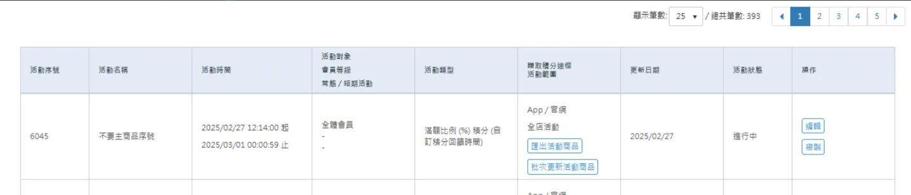

# ExportRewardPromotionSalePage — 匯出活動商品

## 基本資訊

| 項目 | 值 |
|------|-----|
| 批次類型（TypeDef） | `ExportRewardPromotionSalePage` |
| `BatchUploadType` Enum 值 | 166 |
| `BatchUploadExecuteTaskType` Enum 值 | 149 |
| Service | `ExportRewardPromotionSalePageService` |

**UI 截圖**



<br>

---

## 觸發 API（OSM）

```bash
POST https://sms.qa1.hk.91dev.tw/api/PromotionEngine/CreateBatchExportDataTask
```

**Request**

```json
{
    "BatchUploadType": 166,
    "BatchUploadExecuteTaskType": 149,
    "ExportCondition": {
        "PromotionEngineId": 6045,
        "ShopId": 2
    },
    "Password": "",
    "ShopId": 2
}
```

<br>

---

## 主 NMQ Task Data

塞 `BatchUpload Table` → `CreateBatchUploadNMQTask (BatchUpload)`

```json
{
    "BatchUploadId": 11269,
    "SupplierId": 2,
    "UploadType": "ExportRewardPromotionSalePage",
    "UploadUser": "jackyhu@nine-yi.com",
    "FilePassword": "",
    "ExportDataCondition": {
        "ShopId": 2,
        "PromotionEngineId": 5801
    },
    "Country": null
}
```

<br>

---

## Service 流程

**`ExportRewardPromotionSalePageService.cs`** → SCMAPIV2

```bash
POST /v2/Promotion/GetPromotionSalePages
```

**Request Entity**

```csharp
public class GetPromotionSalePagesRequestEntity
{
    public long ShopId { get; set; }   // 商店代碼
    public long Id { get; set; }       // 活動序號
    public string Tag { get; set; }    // 分區標籤
}
```

→ PromotionWeb

```bash
GET /api/promotion-rules/salepage-list
```

Parameters: `ShopId`, `Id`, `Tag`

回傳商品頁清單，依類型分類後產出 Excel 檔案。
