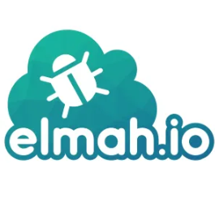

## TW QA

http://elmahdashboard.qa.91dev.tw/?Page=1&Pagesize=300

## TW 各環境 Elmah

https://docs.google.com/spreadsheets/d/1Hh_rOhv8LuZ0b8EAg0qekVf9bFIl7lj72196eD42JZ8/edit?gid=0#gid=0

## Details - 連結

http://elmahdashboard.91app.hk/Log/Details/146df0f5-2a6a-4fc6-bfc4-10c50bc318d2

## 👤 使用者識別說明

Elmah 記錄中的 user 欄位通常顯示為一堆數字
這些數字型態的使用者 ID 通常是測試店家在進行各種操作測試

## 前台寫 elmah 過濾規則

- 前台 elmah 規則可以在各專案的 Web.config, 這裡會記下某些路徑發生 404 的時候要記錄 log 目前包含 /Tmp, /Scripts, /img, /Content, /V2

- /V2 會針對常被攻擊的排除掉一些常常被攻擊的路徑

- /WebAPI 發生 404 錯誤，僅排除 `favicon.ico` 路徑

