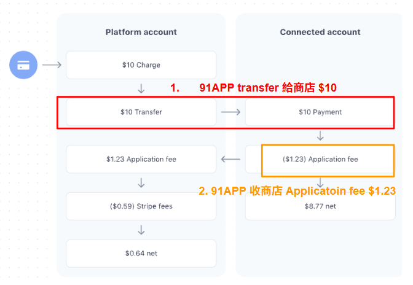

## 7. Stripe 的 Destination mode 金流帳務流向

7.1 detination charge

Full charge amount (10.00 USD) → added to connected account's pending balance

 

Application fee (1.23 USD) → subtracted from the charge and transferred to platform

 

Stripe fees (0.59 USD) → subtracted from platform account's balance

 

Platform 最後淨得 = 1.23 - 0.59 = 0.64 USD

 

| 階段                    | Stripe 內部帳務邏輯                         | 實際金流意義        |
| --------------------- | ------------------------------------- | ------------- |
| 1️⃣ 顧客付款              | $10 → 加到商家 pending                    | 顧客付款成功        |
| 2️⃣ 扣 Application Fee | 商家 -$1.23 → 平台 +$1.23                 | Stripe 自動幫你抽成 |
| 3️⃣ 扣 Stripe Fee      | 平台 -$0.59（手續費）                        | Stripe 收走手續費  |
| ✅ 結果                  | 商家 +$8.77 / 平台 +$0.64 / Stripe +$0.59 | 一次結算完成        |

 

7.2 91 application fee

Application Fee 91向客戶每筆訂單的收費 =
91APP 收客戶的系統使用費 (X%) +
91APP 收客戶的金流手續費利率 (Y%) +
91APP 收客戶的金流手續費固定費用 (HK$Z.ZZ)
*客戶金流手續費每個客戶都不同，由 91APP 在 ERP 設定。

Stripe Fees Stripe 收 91APP 的金流手續費 =
Stripe 收 91APP 利率 (R%)+
Stripe 收 91APP 固定費用 (HK$U.UU)
*此費用由 Stripe 設定

---