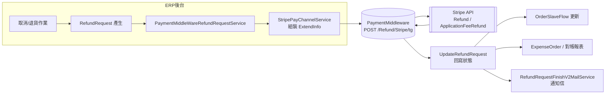

# Stripe 退款機制完整分析

> 專案：`nineyi.scm.nmqv2`
> 範圍：部分退款、補收單（多退少補）、Application Fee 退還、對帳與通知
> 文件性質：程式碼實作分析（非需求規格），所有結論均對應實際原始碼

---

## 目錄

1. [架構總覽](#1-架構總覽)
2. [核心元件與職責](#2-核心元件與職責)
3. [情境 A：部分退款（Partial Refund）](#3-情境-a部分退款partial-refund)
4. [情境 B：補收單（多退少補）機制](#4-情境-b補收單多退少補機制)
5. [情境 C：Application Fee（平台手續費）退還](#5-情境-capplication-fee平台手續費退還)
6. [Stripe 帳號模式與 API Key 選擇](#6-stripe-帳號模式與-api-key-選擇)
7. [退款狀態機與失敗重試](#7-退款狀態機與失敗重試)
8. [對帳報表與 ExpenseOrder](#8-對帳報表與-expenseorder)
9. [Email 通知機制](#9-email-通知機制)
10. [關鍵程式碼索引表](#10-關鍵程式碼索引表)
11. [風險與待確認事項](#11-風險與待確認事項)

---

## 1. 架構總覽

Stripe 退款在 ERP/SCM 系統中並非直接呼叫 Stripe API，而是透過一層 **PaymentMiddleware**（第三方支付中介服務）代理。ERP 端負責「業務邏輯運算」（退款金額、手續費、是否退 Application Fee），PaymentMiddleware 負責「實際打 Stripe API」。



**分工原則**：

| 層級 | 檔案 | 職責 |
|---|---|---|
| 退款單產生 | `ThirdPartyRefundRequestService` / `RefundRequestService` | 依取消單/退貨單計算退款金額，建立 `RefundRequest` |
| 退款派送骨架 | `AbstractPayChannelService` | 定義各金流共通的 Header 組裝、ExtendInfo 抽象方法 |
| Stripe 專屬邏輯 | `StripePayChannelService` | 組裝 `application_fee_amount`、`payment_flow`、`stripe_account`、Stripe API Key Header |
| 中介呼叫 | `PaymentMiddleWareRefundRequestService` | 呼叫 PaymentMiddleware、回寫退款單狀態、觸發後續任務 |
| 費用轉費用單 | `PaymentProcessingFeeExpenseOrderSlaveCreateEntityFactory` | 手續費轉為 `ExpenseOrderSlave` |
| 對帳報表 | `StripeExpenseOrderReportExportService` / `StripePayoutReconciliationReportExportService` | 呈現退款/手續費彙總、下載 Stripe Payout 對帳報告 |
| 通知 | `RefundRequestFinishV2MailService` | 退款完成寄信通知 |

---

## 2. 核心元件與職責

### 2.1 `AbstractPayChannelService`（抽象骨架）

`C:\91APP\NMQ\nineyi.scm.nmqv2\ERP\Backend\BLV2\PayChannel\AbstractPayChannelService.cs`

- `GetRefundHttpHeaders(shopId, tgCode, payType, info, requestId)`：組出共通 Header（`ny-request-id`、`ny-sender`、`ny-pay-type`、`ny-trades-order-group-code`），再合併 `GetPayChannelRefundHttpHeaders(...)` 回傳的金流專屬 Header。
- 抽象方法（由各金流子類別實作）：
  - `GetRefundExtendInfo(shopId, salesOrderThirdPartyPayment, refundRequest)` → 該金流專屬退款附加資訊
  - `GetRefundQueryExtendInfo(shopId, refundRequest)` → 查詢退款結果用的附加資訊
  - `RefundDelay()` / `RefundTaskBookingTime(...)` → 退款延遲/排程時間
  - `GetRedoRefundRequestList(...)` → 重新處理退款清單
- `CanGroupingRefund()` 預設 `false`：Stripe 未覆寫，代表 **Stripe 走「單筆退款單」模式**，非合併批次退款。

### 2.2 `StripePayChannelService`（Stripe 專屬實作）

`C:\91APP\NMQ\nineyi.scm.nmqv2\ERP\Backend\BLV2\PayChannel\StripePayChannelService.cs`

| 方法 | 用途 |
|---|---|
| `GetPayChannelRefundHttpHeaders` | 從 `SalesOrderThirdPartyPayment_Info` 解析 `AccountType`，組出 `X-Secret`（Stripe API Key）Header |
| `GetRefundExtendInfo` | 核心：組出 `payment_flow`、`stripe_account`、`application_fee_amount`、`is_refund_application_fee` |
| `GetRefundQueryExtendInfo` | 恆回傳 `null`（Stripe 不支援 RefundQuery，見 §7） |
| `RefundDelay` | 空實作（Stripe 不需退款延時） |
| `GetPayTypeWithPayChannel` | `GooglePay` / `ApplePay` 會轉換為 `GooglePay_Stripe` / `ApplePay_Stripe`，因這兩者共用 Stripe 通道但 PaymentMiddleware 路由需要區分 |

### 2.3 `PaymentMiddleWareRefundRequestService`（派送與回寫）

`C:\91APP\NMQ\nineyi.scm.nmqv2\ERP\Backend\BLV2\ThirdPartyPayments\PaymentMiddleWareRefundRequestService.cs`

- `CreateRefundRequestFinish()`：撈出待處理退款單，依 `TradesOrderGroupId` 分群並建立 NMQ Task。
- `DoRefundRequestFinish(taskData)`：依金流特性決定走 `RefundByGroupingAmount`（合併退款）或 `RefundByRequestId`（單筆退款，Stripe 屬此類）。
- `Refund(payType, payment, refundRequest)`：組出 `PaymentMiddleWareRefundRequestEntity { RequestId, TransactionId, Amount, Currency, ExtendInfo }`，`POST {Domain}/Refund/{payChannel}/{TradesOrderGroupCode}`。
- `UpdateRefundRequest(...)`：依 PaymentMiddleware 回應的 `ReturnCode` 轉換退款單狀態（成功/失敗），並處理特定金流的失敗重試（見 §7）。

---

## 3. 情境 A：部分退款（Partial Refund）

### 3.1 觸發來源

部分退款主要由 **取消子單（CancelOrderSlave）** 或 **退貨子單（ReturnGoodsOrderSlave）** 觸發，對應到：

- `RefundRequestService.InsertRefundRequestByCancelOrderSlave(...)`
- `ThirdPartyRefundRequestService`（處理含運費、多付款方式攤提之退款單建立）

### 3.2 退款金額計算公式

**單一取消子單（無多付款方式攤提）**：

```
canceledQty = isCancelAllQty ? SalesOrderSlave_Qty : CancelOrderSlave_Qty
amount = (SalesOrderSlave_Price × canceledQty) + totalDiscount
```

> `totalDiscount` 若整單取消採 `SalesOrderSlave_TotalDiscount`，部分取消則採 `CancelOrderSlave_TotalDiscount`（已攤提折扣金額）。

> **「單一取消子單」的計算單位**：對應 `RefundRequestService.InsertRefundRequestByCancelOrderSlave(tradesOrderSlaveId, ...)`，此方法每次只處理**一個 OrderSlave（銷售子單，即訂單中的一個商品項目行）**，而非以 qty 或整張訂單為單位。該 slave 內部再依 `CancelOrderSlave_Qty` 與 `SalesOrderSlave_Qty` 比較，判斷是「整個 slave 全數取消」還是「slave 內部分數量取消」：
>
> ```csharp
> var isCancelAllQty = cancelOrderSlave.CancelOrderSlave_Qty >= salesOrderSlave.SalesOrderSlave_Qty;
> var canceledQty  = isCancelAllQty ? salesOrderSlave.SalesOrderSlave_Qty : cancelOrderSlave.CancelOrderSlave_Qty;
> var totalDiscount = isCancelAllQty ? salesOrderSlave.SalesOrderSlave_TotalDiscount : cancelOrderSlave.CancelOrderSlave_TotalDiscount;
> ```
>
> - `isCancelAllQty = true`：該 slave 購買數量全部取消（含取消數 > 購買數的異常保護），折扣採 `SalesOrderSlave_TotalDiscount`（整單攤提折扣）。
> - `isCancelAllQty = false`：僅取消該 slave 部分數量，折扣採 `CancelOrderSlave_TotalDiscount`（已依取消比例攤提的折扣）。
>
> 程式碼位置：`ERP\Backend\BLV2\RefundRequests\RefundRequestService.cs`（`InsertRefundRequestByCancelOrderSlave`，約行 630–797）。此分支僅處理單一付款方式、無補收單攤提的情境；若涉及退貨補收單或多付款方式攤提，則走下方另兩個公式。

**含補收單金額之取消（退貨情境）**：

```
amount = (CancelOrderSlave_Price × CancelOrderSlave_Qty)
         + CancelOrderSlave_Discount
         + CancelOrderSlave_RechargeReceiptAmount
```

**多付款方式（例如：信用卡 + 購物金 混合支付）攤提**：

系統會先為「其他付款方式」建立各自的退款單並扣除攤提金額，剩餘金額才歸屬 Stripe：

```
amount -= Σ(otherPayTypeAmount.Amount)   // 逐一扣除其他付款方式已攤提部分
```

同時，若涉及運費（`SalesOrderFee`），會**獨立建立一張運費退款單**，也會依付款方式攤提。

### 3.3 0 元退款特殊處理

若計算後 `amount == 0`，退款單會直接被標記為 `Finish` 且 `IsClosed = true`，**不會實際呼叫 Stripe API**（因為沒有金額需要退還，通常發生在多付款情境下該付款方式攤提為 0 的情況）。

### 3.4 端到端流程

```mermaid
sequenceDiagram
    participant ERP as ERP 後台/取消流程
    participant RRS as RefundRequestService /
ThirdPartyRefundRequestService
    participant PM as PaymentMiddleWareRefundRequestService
    participant SPC as StripePayChannelService
    participant MW as PaymentMiddleware
    participant STRIPE as Stripe API
    participant OSF as OrderSlaveFlow

    ERP->>RRS: 取消/退貨子單建立
    RRS->>RRS: 計算退款金額（攤提、運費、補收）
    RRS->>RRS: 建立 RefundRequest（狀態=RefundRequestProcessing）
    Note over RRS: amount=0 直接 Finish，不呼叫 API
    PM->>PM: CreateRefundRequestFinish() 撈待處理退款單
    PM->>SPC: GetRefundExtendInfo(...)
    SPC-->>PM: application_fee_amount / is_refund_application_fee / stripe_account
    PM->>MW: POST /Refund/Stripe/{TgCode}
    MW->>STRIPE: Refund + Application Fee Refund
    STRIPE-->>MW: 退款結果
    MW-->>PM: ReturnCode / TransactionId
    PM->>PM: UpdateRefundRequest（狀態轉換）
    PM->>OSF: RefundFinish / RefundFail 更新大表狀態
    PM->>ERP: RefundRequestFinishV2MailService 寄送通知信
```

### 3.5 運費（SalesOrderFee）退款規則

**重要區分：「取消訂單」與「退貨」是兩套完全獨立的運費退款機制**，一個是系統自動判斷，一個必須人工手動觸發，不可混為一談。

#### 機制 A：取消訂單（CancelOrderSlave）流程 —— 系統自動判斷

邏輯位於 `ERP\Backend\BLV2\RefundRequests\ThirdPartyRefundRequestService.cs` 的 `CreateRefundRequestByCancelFlow`（line 263-298），**只被各付款方式的 `*CancelOrderService.cs`（如 `AtmCancelOrderService`、`LinePayCancelOrderService` 等）呼叫**，是「取消訂單」流程專屬邏輯，跟「退貨」完全無關。

**第一道關卡：必須整張母單（SalesOrder）所有子單都取消**

```csharp
if (isAllCanceled == false)
{
    return Tuple.Create(0, salesOrderFee);   // 直接不處理運費退款
}
```

訂單裡只要還有其他商品沒取消（部分取消），運費完全不退——因為運費是綁在整張母單上，只要還有東西要出貨，這筆運費就算「有在用」。

**第二道關卡：只有以下兩種情況，才會真的建立一張獨立的運費 RefundRequest（`RefundRequest_SourceDef = SalesOrderFee`）：**

- **運費單完全沒被使用**（`SalesOrderFee_TradesOrderSlaveId == null`）：消費者根本還沒出貨就把整張訂單取消了，運費本來就沒發生物流成本，全額退還。
- **出貨後「超商驗收失敗」**（`VerifyFailAbnormalPackage` / `VerifyFailErrorCode` / `VerifyFailInvalidCode` / `VerifyFailLost` / `VerifyFailRenovation` 共 5 種狀態）：貨物寄到超商但沒有真正送達消費者手上（超商拒收、遺失、包裝異常等），等同出貨沒有成功完成，同樣退運費。

以上兩道關卡皆通過，系統才會在**取消訂單處理當下**自動建立這筆運費退款單，商家不需要另外操作。

#### 機制 B：退貨（ReturnGoodsOrderSlave）流程 —— 必須人工手動觸發，系統不會自動退運費

追蹤 `SCMAPIV2\BusinessLogic\Services\ReturnGoodsOrders\ReturnGoodsOrderFinishService.cs`（退貨結案邏輯）後確認：**整段退貨結案流程完全沒有任何自動建立 SalesOrderFee 退款的程式碼**。運費退款要靠獨立的 API：

```
POST /RefundRequest/ReturnSalesOrderFee   // RefundRequestController.cs line 37-42
→ RefundRequestService.ReturnSalesOrderFee(entity)   // line 178，用 this._userService.GetUserName() 記錄操作人
```

這代表**商家／客服必須在 SCM 賣家後台手動點擊「退運費」按鈕**才會呼叫這支 API 建立運費退款單，退貨單結案本身**不會**自動連動觸發，兩者是脫鉤的。若商家忘記手動點退運費，消費者就不會收到運費退款。

**情境比較：**

| 情境 | 觸發流程 | 運費是否退還 | 是否需人工操作 |
|---|---|---|---|
| 消費者下單後隔天反悔，商品尚未出貨就整單取消 | 取消訂單（機制 A） | ✅ 全額退還運費 | 否，系統自動判斷並建立 |
| 商品已出貨到超商，但超商驗收時發現包裝異常拒收，貨退回倉庫，消費者順勢取消訂單 | 取消訂單（機制 A） | ✅ 退還運費（等同貨未送達） | 否，系統自動判斷並建立 |
| 消費者已收到貨，使用一週後申請退貨（正常完成配送） | 退貨（機制 B） | 視商家是否手動處理而定 | **是**，須客服／商家在 SCM 後台手動點「退運費」 |

**結論**：「取消訂單」的運費退款是系統自動判斷（依出貨/驗收狀態）；「退貨」的運費退款則必須商家手動操作，系統本身不會因為退貨結案就自動退運費——若商家未手動處理，消費者已收到貨後申請退貨時，運費預設不會退還，等於商家吸收**出貨**運費成本，除非客服主動決定手動退運費補償消費者。至於「消費者把商品寄回商家」的**退貨逆物流運費**，並不在這套 `RefundRequest` 機制內處理——它是物流/客服另外決定是否提供免運寄件標籤的營運成本，不會反映在 Stripe 退款金額或 `RefundRequest` 資料表裡。

---

## 4. 情境 B：補收單（多退少補）機制

### 4.1 業務情境

「多退少補」發生在**換貨/退貨導致商品差額**時：若換貨後應付金額 **大於** 原付款金額，系統會開立一張 **補收單（RechargeReceipt）** 向消費者收取差額；若原退款金額中包含這筆補收，Stripe 手續費的計算就不能單純以退款金額為基礎，必須排除已透過補收單收回的手續費成本。

### 4.2 補收單五種類型與情境範例

補收單（`RechargeReceipt`）是一個通用機制，涵蓋「退貨/換貨過程中需要向消費者額外收費」或「出貨前客服手動退費」兩大用途，由 `RechargeTypeDefEnum` 分成 5 種（`SCMAPIV2\...\RechargeReceipts\Enums\RechargeTypeDefEnum.cs`）：

| 類型 | 建立時機 | 金額方向 | 情境範例 |
|---|---|---|---|
| `ActionOrDiscountSpreads`（活動/折扣差價） | 退貨進行中 | 正值（向消費者追收） | 消費者買 3 件湊到「滿 3000 折 300」，退貨 1 件後剩下商品只值 2000 元、不再滿足門檻，需追回當初多折的 300 元優惠。 |
| `PackageOrRenewFee`（包裝/整新費） | 退貨進行中 | 正值 | 消費者退回的商品已拆封使用，需要清潔/整新才能重新上架，收取 200 元整新處理費。 |
| `SaleProductGift`（贈品） | 退貨進行中 | 正值 | 訂單買一送一，消費者只退回主商品、贈品未退回（弄丟/已使用），以贈品市價折抵扣款。 |
| `SalesOrderFee`（運費） | 退貨進行中 | 正值 | 原訂單滿 1000 免運，退貨後剩餘商品金額掉到 800、不再達免運門檻，向消費者收取運費差額。 |
| `OrderSpreads`（負向 訂單差價） | 出貨前，訂單**不取消**由客服手動退費（`RechargeReceiptService.CreatePartialAmount`） | **負值**（代表已退給消費者） | 商品有小瑕疵，客服決定退 200 元給消費者但商品照樣出貨（不取消訂單），系統存 `RechargeReceipt_RechargeAmount = -200`。 |

> **為什麼 `OrderSpreads` 一定要存負值？** 因為這筆錢是「已經退給消費者、但訂單還沒被取消」的紀錄。若日後這筆訂單子單又整張被取消，退款金額公式 `amount = Price×Qty + Discount + RechargeReceiptAmount` 必須把先前已退的 200 元扣掉（`1000 + 0 + (-200) = 800`），否則消費者會拿到 `1000 + 200 = 1200`，造成**重複退款**。
>
> 前 4 種類型則相反：一律為**正值**，且必須綁在「進行中的退貨子單（`ReturnGoodsOrderSlave`）」上才能建立（`RechargeReceiptService.Create()` 會檢查 `GetProcessingReturnGoodsInfoForRechargeReceipt`），用途是退貨當下就先向消費者扣抵這些額外費用，避免退款金額退多了。

### 4.3 相關資料結構

| Entity / Enum | 說明 |
|---|---|
| `RechargeReceiptStatusEnum` | `Created`（已建立）/ `Finished`（已結案）/ `Void`（已作廢） |
| `RechargeReceipt_RechargeAmount` | 補收單整筆金額（單一付款方式訂單使用） |
| `RechargeReceiptPayProfileType`（分攤表）| 多付款方式訂單時，記錄每個付款方式各自分攤的補收金額 |
| `GetRechargePayTypeAmountByReceiptIdAndPayProfileType(receiptId, payProfileTypeDef)` | 依補收單 Id + 付款方式查詢分攤金額，查無則 fallback 用整筆金額 |

### 4.4 計算邏輯（`StripePayChannelService.GetRefundExtendInfo`）

僅當 `RefundRequest_SourceDef == ReturnGoodsOrderSlave`（退貨子單）且補收單存在、狀態非 `Void` 時才會進入此分支：

```csharp
// 1. 取得此付款方式的補收分攤金額（無分攤紀錄則用整筆金額）
rechargeAmount = GetRechargePayTypeAmountByReceiptIdAndPayProfileType(receiptId, payProfileTypeDef)
                     ?? RechargeReceipt_RechargeAmount;

// 2. 一致性檢查：退款金額 + 補收金額 必須等於「該付款方式的分攤支付總額」
totalPayment = refundAmount + rechargeAmount;
expectedTotalPayment = GetOtherPayTypeAmount(tsCode, payProfileTypeDef)?.Amount
                           ?? SalesOrderSlave_TotalPayment;
if (expectedTotalPayment != totalPayment) throw new ApplicationException(...);

// 3. 手續費計算
rechargeAmountFee  = CalculateFee(rechargeAmount, feeRate);          // 補收單本身應收的手續費
totalPaymentFee    = CalculateFee(refundAmount + rechargeAmount, feeRate); // 原始交易總額對應手續費

// 4. 最終應退還手續費 = 原交易手續費 - 補收單手續費
refundApplicationFee = totalPaymentFee - rechargeAmountFee;
```

> `CalculateFee(amount, rate)`：`Math.Round(amount × rate, 2, MidpointRounding.AwayFromZero)`，若結果 `<= 0` 則保底回傳 `0.01`（避免出現 0 或負數手續費傳給 Stripe API 導致錯誤）。

### 4.5 範例試算

假設訂單原始金額 **100 元**、Stripe 費率 **3%**、退貨金額 **70 元**、補收單 **30 元**（單一付款方式，無分攤情境）：

| 步驟 | 公式 | 結果 |
|---|---|---|
| ① 一致性檢查 | `70 + 30 = 100`（等於原總支付金額）| ✅ 通過 |
| ② 原交易手續費 | `CalculateFee(70 + 30, 3%) = 100 × 3%` | **3.00** |
| ③ 補收單手續費 | `CalculateFee(30, 3%) = 30 × 3%` | **0.90** |
| ④ 應退還手續費 | `③ 原交易手續費 − 補收單手續費` = `3.00 − 0.90` | **2.10** |

**意義**：訂單原本收了 100 元的 3% = 3 元手續費；換貨後透過補收單重新收了 30 元、對應手續費 0.9 元也已由補收單流程收取，因此僅需退還「差額部分」的手續費 2.10 元，避免手續費被重複退還或漏退。

### 4.6 多付款方式下的分攤

若訂單同時使用信用卡（Stripe）與購物金付款，系統會優先以 `RechargeReceiptPayProfileType`（分攤表）查出 Stripe 這筆付款方式對應的補收分攤金額，而非直接使用補收單全額，避免將購物金部分的補收金額誤算入 Stripe 手續費退還計算。

---

## 5. 情境 C：Application Fee（平台手續費）退還

### 5.1 適用情境與模式

Application Fee 機制**專屬於 `DestinationCharge`（目的地收費）流程 + `Custom` 帳戶類型**：平台以 Custom Connect 帳戶代收款項後，透過 `application_fee_amount` 從賣家所得中抽取平台服務費，因此退款時同步涉及「是否／如何退還這筆已扣的服務費」。

| 概念 | 資金流向 | 對應本專案欄位 |
|---|---|---|
| Refund（退款） | 平台 → 顧客 | `RefundRequest_Amount` |
| Application Fee Refund（手續費退還） | 平台 → 賣家（子帳號） | `application_fee_amount` |

### 5.2 是否退還手續費的判斷（`IsRefundApplicationFee`）

```csharp
bool IsRefundApplicationFee(refundRequest, salesOrderSlaveDateTime, shopId)
{
    if (refundRequest.SourceDef != SalesOrderFee)   // 非運費退款
        return true;                                 // → 一律退還手續費

    // 運費退款：需符合日期門檻或商店白名單設定才退手續費
    return salesOrderSlaveDateTime >= 2020-07-01
           || shopArray(config: "Charge.SalesOrderFee.Shop").Contains(shopId);
}
```

- 非運費類退款（商品退貨、取消單）：**永遠退還 Application Fee**。
- 運費類退款：因 2020/07/01 前的歷史政策運費不退手續費，故加上日期與商店白名單雙重判斷（可透過 `AppSetting: Charge.SalesOrderFee.Shop` 針對特定商店提前開通）。

### 5.3 手續費金額計算

一般情境（無補收單）：

```
refundApplicationFee = CalculateFee(refundAmount, feeRate)
                      = Math.Round(refundAmount × feeRate, 2, AwayFromZero)
                      = 至少 0.01（保底值，避免傳 0 或負值給 Stripe）
```

補收單情境：見 §4.4（`原交易手續費 − 補收單手續費`）。

### 5.4 傳遞給 PaymentMiddleware / Stripe 的資訊

`GetRefundExtendInfo` 最終組出的 `ExtendInfo` 內容：

```json
{
  "payment_flow": "DirectCharge | DestinationCharge",
  "stripe_account": "子帳號 ID（Custom 帳戶時）",
  "application_fee_amount": 2.10,
  "is_refund_application_fee": true
}
```

由 PaymentMiddleware 接手後，才實際呼叫 Stripe：
- `POST /v1/refunds`（退款本體）
- `POST /v1/application_fees/{applicationFeeId}/refunds`（若 `is_refund_application_fee = true`）

> **注意**：ERP 端不直接持有 `applicationFeeId`；`payment_flow` + `stripe_account` + `TransactionId` 由 PaymentMiddleware 用以反查對應的 Application Fee 紀錄。

### 5.5 `payment_flow` 與 `stripe_account` 的取得邏輯

```csharp
GetRefundFlowAndSubAccount(shopId, thirdPartyPaymentInfo)
{
    if (thirdPartyPaymentInfo 為空)
        return ("DirectCharge", ShopDefault.StripeSubAccount);  // 無訂單層級資訊時，回退商店預設子帳號

    info = Deserialize(thirdPartyPaymentInfo);
    paymentFlow = info.PaymentFlow ?? "DirectCharge";
    return (paymentFlow, info.SubAccount);
}
```

---

## 6. Stripe 帳號模式與 API Key 選擇

### 6.1 帳戶類型（`StripeAccountTypeConstants`）

| 常數 | 意義 |
|---|---|
| `Standard` / `StandardUAT` | 標準帳戶，走 `DirectCharge` |
| `Custom` / `CustomTest` | Custom Connect 帳戶，走 `DestinationCharge`，支援 Application Fee |
| `CustomUAT` / `CustomUATTest` | Custom 帳戶的 UAT 測試環境版本 |

### 6.2 API Key 對照（`StripeApiKeyRetriever.GetStripeApiKey`）

| AccountType | 對應金鑰 |
|---|---|
| `Custom` | `CustomAcctLiveSecretKey` |
| `CustomTest` | `CustomAcctTestSecretKey` |
| `CustomUAT` | `CustomUATAcctLiveSecretKey` |
| `CustomUATTest` | `CustomUATAcctTestSecretKey` |
| `Standard` | `StandardAcctLiveSecretKey` |
| `StandardUAT` | `StandardUATAcctLiveSecretKey` |
| 其他/未知 | fallback → `StandardAcctLiveSecretKey` |

此金鑰會放入退款請求的 `X-Secret` Header，由 PaymentMiddleware 用來對 Stripe 進行身份驗證；ERP 端本身**不直接持有 Stripe Secret Key 以外的憑證**，實際 API 呼叫皆委由 PaymentMiddleware 執行。

### 6.3 `PaymentProcessingFeeExpenseOrderSlaveCreateEntityFactory` 中的帳戶類型限制

金流手續費要轉為費用單（ExpenseOrderSlave）需同時滿足：
1. `AppSetting: ExpenseOrder.PaymentProcFee.{PayProfileType}.IsEnableCreateExpenseOrder = true`
2. 訂單付款狀態為 `Success`
3. `SalesOrderThirdPartyPayment_Info` 非空
4. **`AccountType` 必須以 `Custom` 開頭**（`Standard` 帳戶不會產生手續費費用單，因其手續費由 Stripe 直接向平台收取，非透過 Custom 子帳號代收代付模式）

---

## 7. 退款狀態機與失敗重試

### 7.1 狀態轉換

`RefundRequest_StatusDef` 主要狀態：`RefundRequestProcessing` → `RefundRequestGrouping`（若走合併）→ `Finish` / `RefundRequestFail`。

- **`RefundFinish`**：標記 `Finish`、`IsClosed = true`，並回寫 `OrderSlaveFlow`（若非運費退款）。若來源為 `CancelOrderSlave`，訂單狀態同步為「訂單取消」；其餘則進入標準 `RefundFinish` 狀態流。
- **`RefundFail`**：標記 `RefundRequestFail`，清空匯款檔名 / 確認日 / 預計撥款日，並將 `OrderSlaveFlow` 打回 `RefundProcessing` 讓後續可重試。

### 7.2 Stripe 是否支援 RefundQuery / 失敗重試

- `StripePayChannelService.GetRefundQueryExtendInfo` **恆回傳 `null`**：Stripe 通道**不支援退款結果查詢（RefundQuery）**機制，代表退款結果須靠 PaymentMiddleware 同步回應或後續回檔確認，無法主動輪詢 Stripe 狀態。
- `PaymentMiddleWareRefundRequestService.PaymentTypeRetryableErrorCodes` 目前僅為 **Razer 系列與 KPay** 設有「特定錯誤碼 + 3 日內自動轉重試」邏輯，**Stripe 不在此清單中**，代表 Stripe 退款失敗後不會被系統自動轉為重試，需人工介入處理。

---

## 8. 對帳報表與 ExpenseOrder

### 8.1 `PaymentProcessingFeeExpenseOrderSlaveCreateEntityFactory`

將金流手續費轉為 `ExpenseOrderSlave`（費用子單）：

- `ItemTypeDef = PaymentProcFee`
- `ChangeAmountType = Negative`（費用支出，減項）
- `ChangeAmount = TotalPayment`、並帶入 `FixedFee` / `FeeRate`
- 帳期（Period）依日期切為每月 1 日 / 16 日兩期

> **FixedFee / FeeRate 來源**：來自 `SalesOrderGroupRepository.GetSalesOrderGroupPaymentProcessingFeeInfo()`：
> ```csharp
> FixedFee = salesOrderGroup.SalesOrderGroup_PaymentFixedFee,
> FeeRate  = salesOrderSlave.SalesOrderSlave_SCMCreditCardFeeRate ?? 0.00m
> ```
> - `FixedFee` 來自訂單主檔欄位 `SalesOrderGroup_PaymentFixedFee`。
> - `FeeRate` 來自銷售子單欄位 `SalesOrderSlave_SCMCreditCardFeeRate`。
>
> 兩者都是**訂單成立當下寫入的快照值**（代表當時商店與金流商議定的手續費率/固定手續費），退款/對帳時直接讀這筆歷史快照，**不會**在退款當下重新查詢最新費率設定，確保費率不會因日後費率調整而追溯影響已完成訂單的計算。

### 8.2 `StripeExpenseOrderReportExportService`（Stripe 帳務對帳報表）

彙總退款來源（`RefundSourceDefs`）：`ReturnOrderRefund`、`CancelOrderRefund`、`AbnormalOrderRefund`、`OrderFeeRefund`；
彙總手續費來源（`TransactionFeeSourceDefs`）：`CreditCardOnce_Stripe`、`ApplePay`、`GooglePay`。

報表核心欄位：

| 欄位 | 意義 |
|---|---|
| `TotalStripeFee` / `TotalApplePayFee` / `TotalGooglePayFee` | 各支付方式系統手續費彙總 |
| `TotalStripePaymentProcessingFee` 等 | 各支付方式的金流處理手續費彙總 |
| `FirstSystemFee`（正流程為負、逆流程為正） | 依 `SourceDef` 分正逆流程計算手續費符號 |
| `totalExclScFee` | 排除購物金退款後的手續費總額（購物金退款 `FirstSystemFee` 固定為 0） |

`CalculateFee(sourceDef, amount, feeRateNote)` 對 Stripe 類來源使用 `StripeFeeEntity`（`FeeRate` + `FixedFee`）計算：`Math.Round(amount × FeeRate + FixedFee, 小數位, AwayFromZero)`。

> **是否為獨立報表？**：是**兩個獨立的報表類型**，但共用同一套 ERP 匯出框架。兩者都在 `BatchUploadTaskProcessSetting.cs` 註冊為不同的 `BatchUploadTypeEnum`：
> ```csharp
> .RegisterBatchUploadTaskService<StripePayoutReconciliationReportExportService>(builder, BatchUploadTypeEnum.ExportStripePayoutReport)     //// Stripe 入帳明細匯出
> .RegisterBatchUploadTaskService<StripeExpenseOrderReportExportService>(builder, BatchUploadTypeEnum.ExportStripeExpenseOrderReport)   //// Stripe 對帳明細匯出
> ```
> 兩者都繼承 `BatchUploadBaseService<T>`，跟 ERP 後台其他「批次匯出」報表走同一套非同步匯出機制（建立 BatchUpload 任務 → NMQ 背景處理 → 產檔供下載），但**資料來源與計算邏輯完全獨立**：本節（8.2）報表讀 ERP 內部 `ExpenseOrderSlave` 退款/手續費資料；下方 8.3 的 Payout 對帳報表則讀 **Stripe Reporting API** 的資料。

### 8.3 `StripePayoutReconciliationReportExportService`

呼叫 Stripe Reporting API 產生/下載 Payout 對帳報告（`GetReportRun` → 輪詢完成狀態 → 下載檔案並壓縮），用於核對 Stripe 實際撥款金額與系統紀錄是否一致，是退款/手續費計算正確性的最終防線。

> **什麼時候會執行？**：是使用者在 ERP 後台**手動觸發**的匯出任務，**不是排程 Cron Job**。流程（`StripePayoutReconciliationReportExportService.DoProcess`）：
> 1. 使用者在 ERP 後台選店家、指定 `StripeReportRunId`（已在 Stripe 建立的 Report Run）並送出匯出請求。
> 2. 系統呼叫 Stripe API 查詢該 Report Run 狀態：
>    ```csharp
>    if (reportRun.Status == "pending" || stripeFile == null || ...)
>    {
>        Thread.Sleep(TimeSpan.FromMinutes(5));
>        return;   // 尚未完成，5 分鐘後由 NMQ 重試
>    }
>    ```
> 3. Report Run 完成後才下載檔案、壓縮加密，供使用者下載。
>
> 也就是「使用者按下匯出 → 系統輪詢等 Stripe 那邊報表跑完 → 才真正下載」，執行時機取決於使用者操作 + Stripe Reporting API 產生報表的速度（非固定排程）。

---

## 9. Email 通知機制

`RefundRequestFinishV2MailService`：

- 依 `TradesOrderGroupCode` 撈出該訂單群組已完成之退款單（`GetRefundRequestFinishListByTradesOrderGroupId`）。
- **退款總額為 0 時不寄信**，避免對消費者造成不必要的通知困擾。
- 信件內容包含：退款方式、商品明細、退款金額、訂單資訊；`SalesOrderFee`（運費）退款會作為獨立項目列示，與商品退款區隔顯示。

**寄信條件（需同時滿足 3 項，缺一都不會寄出退款完成通知信）：**

1. **商店未關閉此類通知**（`IsSendMail()` line 431）：
   ```csharp
   if (salesOrderItem != null && base.IsShopNeedSendMail(salesOrderItem.SalesOrder_ShopId, ShopCustomDisableMailSettingEnum.DisableRefundFinish) == false)
       return false;
   ```
   商店可透過 `ShopCustomDisableMailSettingEnum.DisableRefundFinish` 自訂關閉退款完成信。
2. **會員本身有訂閱該類通知**：`IVipMemberEmailNotificationService.IsSendMail(memberId, shopId, EmailNotificationEnum.TradesOrder)`——會員個人的訂單通知偏好設定。
3. **這批退款單加總金額不為 0**（`DoMailDataProcess` line 144）：
   ```csharp
   var sum = refundRequestList.Sum(x => x.RefundRequest_Amount);
   if (sum == 0)
   {
       this.ProceedSendMail = false;   // 0 元退款不寄信
       return;
   }
   ```

---

## 10. 關鍵程式碼索引表

| 主題 | 檔案路徑 |
|---|---|
| 退款骨架（抽象類別） | `ERP\Backend\BLV2\PayChannel\AbstractPayChannelService.cs` |
| Stripe 退款邏輯 | `ERP\Backend\BLV2\PayChannel\StripePayChannelService.cs` |
| 退款單狀態機 | `ERP\Backend\BLV2\RefundRequests\RefundRequestService.cs` |
| 取消/退貨退款單建立 | `ERP\Backend\BLV2\RefundRequests\ThirdPartyRefundRequestService.cs` |
| PaymentMiddleware 呼叫與回寫 | `ERP\Backend\BLV2\ThirdPartyPayments\PaymentMiddleWareRefundRequestService.cs` |
| 手續費 → 費用單工廠 | `ERP\Backend\BLV2\ExpenseOrders\PaymentProcessingFeeExpenseOrderSlaveCreateEntityFactory.cs` |
| 費用來源列舉 | `ERP\Backend\BE\ExpenseOrder\ExpenseOrderSlaveSourceDefEnum.cs` |
| Stripe 手續費 DTO | `ERP\Backend\BE\ExpenseOrder\FeeRateNotes\StripeFeeEntity.cs` |
| 補收單狀態列舉 | `ERP\Backend\BE\RechargeReceipt\RechargeReceiptStatusEnum.cs` |
| 補收單分攤查詢 | `ERP\DA\ERPReadDBV2\Repositories\RechargeReceiptRepository.cs` |
| Stripe 付款流程/帳戶類型常數 | `ERP\Backend\BE\Stripes\Constants\StripePaymentFlowConstants.cs`、`StripeAccountTypeConstants.cs` |
| Stripe API Key 取得 | `ERP\Backend\BLV2\Stripes\StripeApiKeyRetriever.cs` |
| 第三方付款資訊 DTO | `ERP\Backend\BE\SalesOrderThirdPartyPayment\Info\StripeSalesOrderThirdPartyPaymentInfoEntity.cs` |
| 取消訂單觸發退款入口 | `SCM\Frontend\NMQV2\CancelOrder\ThirdPartyCancelOrderProcess.cs` |
| Stripe 帳務對帳報表 | `SCM\Frontend\BLV2\BatchUpload\StripeExpenseOrderReportExportService.cs` |
| Stripe Payout 對帳下載 | `SCM\Frontend\BLV2\BatchUpload\StripePayoutReconciliationReportExportService.cs` |
| 退款完成通知信 | `ERP\Backend\BLV2\Email\RefundRequestFinishV2MailService.cs` |

---

## 11. 風險與待確認事項

1. **Stripe 無 RefundQuery**：一旦 PaymentMiddleware 呼叫逾時或網路異常，系統無法主動查詢 Stripe 實際退款結果，需仰賴人工於 Stripe Dashboard 核對，或等待 Payout 對帳報告比對。
2. **Stripe 無自動失敗重試**：`PaymentTypeRetryableErrorCodes` 未涵蓋 Stripe，退款失敗後需人工重新觸發，可能影響退款時效與客服應對。
3. **補收單一致性檢查若失敗會拋例外**（`ApplicationException`）：`退款金額 + 補收金額 != 分攤支付總額` 時整筆退款流程中斷，需確保上游取消/換貨流程金額計算與此處假設完全一致，否則會造成退款卡住。
4. **運費手續費退還之日期/白名單雙軌判斷**（2020/07/01 分界 + `Charge.SalesOrderFee.Shop` 設定）為歷史相容邏輯，新商店上線時需留意此設定是否已正確配置，否則運費手續費可能未被退還。
5. **`CalculateFee` 保底 0.01 邏輯**：當計算結果 `<= 0` 時一律回傳 `0.01`，代表極小額退款情境下手續費退還金額並非嚴格比例計算，屬人為設計的保底規則，非 Stripe 官方規範，異動費率設定時應留意此例外分支。

---

*文件產生依據：程式碼靜態分析（`nineyi.scm.nmqv2` repository），如上游邏輯異動請同步更新本文件。*
