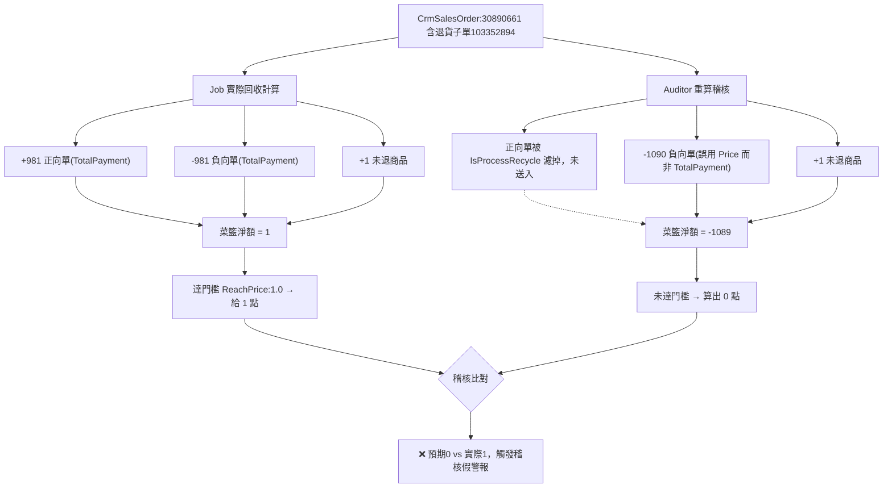

## 🚨 異常訊息

```bash
線下訂單點數回收紀錄稽核監控到異常
市場環境: HK-Prod
CrmSalesOrderSlaveId: 103352894
稽核到下列異常:
訂單36675_CrmSalesOrder:30890661給點後:重新計算預期給點0 與實際回收後點數 1 不同
```

## 📋 問題原因（兩個 Bug 疊加）

| Bug | 問題描述 | 影響 |
|---|---|---|
| **Bug 1：欄位拿錯** | `TotalPayment` 誤賦值成 `i.Price`（單品售價，未折扣），而非 `i.TotalPayment`（應收金額，已折扣） | 退貨金額算成 -1090，而非正確的 -981（差 109，即該筆折扣金額） |
| **Bug 2：誤濾正向單** | 只要正向單被退貨勾稽（`IsProcessRecycle == true`），就整筆從菜籃中排除 | 遺漏 +981 的原始正向單，只剩負向單「單邊淨額」送入促購引擎 |

## 🔍 根因分析

### Bug 1：`Price` 與 `TotalPayment` 意義不同（CRM DB 欄位定義）

`CrmSalesOrderSlave.cs`（`Nine1.Promotion.Console.DA.CRMDB\Models\CrmSalesOrderSlave.cs`）：

```csharp
/// <summary>單品售價</summary>
public decimal CrmSalesOrderSlavePrice { get; set; }

/// <summary>應收金額</summary>
public decimal CrmSalesOrderSlaveTotalPayment { get; set; }

/// <summary>折扣金額</summary>
public decimal CrmSalesOrderSlaveLoyaltyPointDiscount { get; set; }
```

- `Price`（單品售價）= **1090**：商品原始標價，未扣任何折扣。
- `TotalPayment`（應收金額）= **981**：實際結帳應收/實付金額，已扣除折扣（例如紅利折抵、會員折扣等）。
- 差額 `1090 - 981 = 109`，就是這筆退貨子單原本結帳時被折抵掉的金額。

### 稽核程式錯誤位置

**檔案**：`src\Nine1.Promotion.Console.BL\Services\PromotionReward\Auditors\PromotionRecycleReCalculatePointsRecordAuditor.cs`
**方法**：`GetCrmRecycleOrderDataAsync`

```csharp
// 第 292 行（原始正向單）
TotalPayment = i.Price,                          // ❌ 應為 i.TotalPayment

// 第 297 行（原始正向單，Bug 2 的過濾標記來源）
IsProcessRecycle = returnedOriginalOrderIds.Contains(i.CrmSalesOrderSlaveId)

// 第 312 行（退貨負向單）
TotalPayment = i.Price > 0 ? -i.Price : i.Price,  // ❌ 應為 i.TotalPayment
```

`GetExpectedPointsAsync` 中：

```csharp
var normalOrderData = orderSlaves.Where(order => order.IsProcessRecycle == false);
```
→ 只要正向單被 `IsProcessRecycle` 標記為 true（表示有退貨勾稽），就會被整筆濾掉，不會送入促購引擎菜籃。

### 正式 Job 的正確作法（對照組）

**檔案**：`src\Nine1.Promotion.Console.BL\Services\Promotions\OthersCrmSalesOrderPromotionRewardCalculateService.cs`

- `GetPromotionRecycleOrderData` / `GetPromotionRewardOrderData`：正向單、負向單**各自獨立建立成 SKU 明細**，都會送入菜籃，不會預先過濾正向單。
- `GetPromotionSalepageSku`（約第 122～130 行）：
  ```csharp
  var basePrice = orderSlave.Qty == 0 ? 0 : (orderSlave.TotalPayment / orderSlave.Qty).TruncateTo(digits);
  ```
  明確使用 `TotalPayment`（實付金額）而非 `Price`。

## ⚙️ 業務邏輯說明



## ⚠️ 結論

這筆 HK-Prod 稽核異常是**稽核程式本身的邏輯 Bug 造成的假陽性（False Positive）**，不是真實的點數回收錯誤。`RecycleLoyaltyPointsV2Job` 實際回收後保留 1 點是正確結果。

## 🔧 修正建議

1. **欄位修正**（`GetCrmRecycleOrderDataAsync` 第 292、312 行）：
   ```csharp
   // 原始正向單
   TotalPayment = i.TotalPayment,

   // 退貨負向單
   TotalPayment = i.TotalPayment > 0 ? -i.TotalPayment : i.TotalPayment,
   ```

2. **移除/修正 `IsProcessRecycle` 過濾邏輯**：正向單、負向單都應送入菜籃（比照正式 Job 的 `GetPromotionRecycleOrderData` 做法），不要在資料組成階段就把已勾稽的正向單濾掉，讓促購引擎自己處理正逆抵銷。

3. 建議一併確認：
   - `IsMemberCollectionRequired` 應依 `existingUserTag` 是否存在來判斷（Recycle 且有值時應為 `false`），Auditor 目前寫死 `true`。
   - `Shipping.LocationId` 未帶入 Request，可能影響地區類活動規則判斷。
   - `user.Tags` 用 `Concat` 未去重（應比照正式邏輯用 `Union`）。
   - 訂單資料來源：Auditor 用稽核當下傳入的快照資料，Job 是即時重新查詢 DB，兩者時間差也可能造成資料不同步。

4. 修正後建議針對 `CrmSalesOrder:30890661`（活動 36675）重新跑一次稽核驗證，預期 `expectedRewardPoints` 應變成 1，稽核即可通過。
