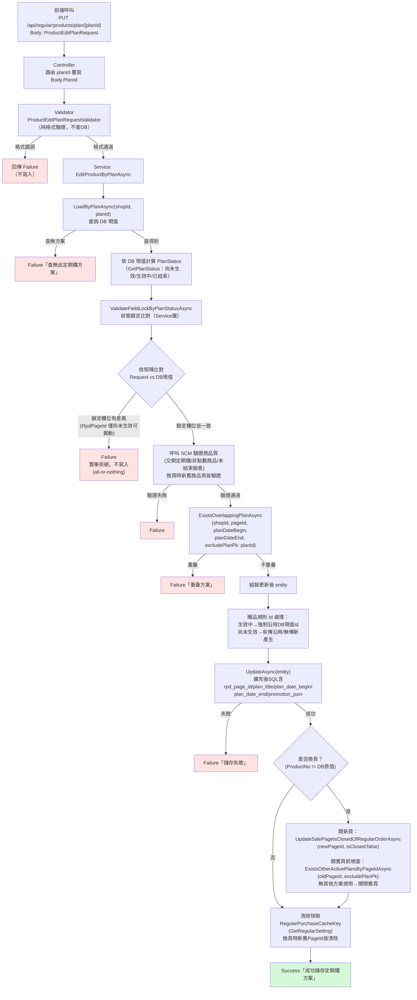

# Regular V2 API — 編輯定期購方案 實作規劃（Implementation Plan）

> 本文件為 `nine1.regularpurchase.v2` 下游 API 的**實作規劃文件**，聚焦於後端內部設計決策與異動範圍。
> 對應 EPIC：**定期購支援贈品_202607**。
> ⚠️ 本文件**不涵蓋** OSM 前端實際呼叫的 `Api/RegularProduct/Edit` 對外規格（含 SMS `ApiResultEntity` 包裝格式、前端錯誤文案對照等），該部分待後續另行整理為獨立的前端對接 Spec 文件。

---

## 1. 背景與目標

現況 `EditProductAsync`（`PUT /api/regular/products/{productNo}`）僅能修改配送設定，且以 `productNo` 定位「單一啟用中商品」。但同一商品頁可能對應**多筆方案**（不同生效期間），需求要求：

1. 以 `planId`（`rpd_pk`）精準定位單一方案
2. 依方案狀態（尚未生效／生效中／已結束）限制可修改欄位範圍
3. 開放方案名稱、生效結束時間、贈品缺貨處理等既有 Edit 不支援的欄位

**決策：新增一支獨立的 API，不修改/共用舊有 `PUT /{productNo}` 相關程式（DTO／Validator／Service 方法／Controller Action 皆獨立）。舊路由暫不處理，維持現況。**

---

## 2. 新增／異動清單總覽

| 層 | 項目 | 異動類型 | 說明 |
|---|---|---|---|
| Repository | `ExistsOverlappingPlanAsync` | **異動既有方法**（加 optional 參數） | 加 `long? excludePlanPk = null`，Edit 排除自己這筆方案；Add 呼叫端不需改動 |
| Repository | `LoadByPlanAsync` | 不異動，直接複用 | 既有查詢方法（供 `GetDetail` 使用），確認欄位齊全可供 Update 前置查詢使用 |
| DTO | `ProductEditPlanRequest`（新檔） | **新增，獨立於 `ProductEditRequest`** | 見第 4 節 |
| Validator | `ProductEditPlanRequestValidator`（新檔） | **新增，獨立於 `ProductEditRequestValidator`**（若存在） | 見第 5 節 |
| Service | `EditProductByPlanAsync`（新方法） | **新增，獨立於 `EditProductAsync`** | 見第 6 節 |
| Service（共用邏輯抽取） | 「生效期間 vs 銷售期間」「重疊檢查」 | **重構**：從 `ValidateSalePageDataForAddAsync` 抽出共用 private method | Add／Edit 共用，Edit 額外帶 `excludePlanPk` |
| Controller | `EditProductByPlanAsync`（新 Action） | **新增** | `PUT /api/regular/products/plan/{planId}` |
| 單元測試 | `RegularProductServiceTests.cs` | **新增測試案例** | 三種狀態情境 + 重疊排除自己 |

---

## 3. 依方案狀態的欄位可編輯矩陣

方案狀態沿用既有 `PlanStatusEnum`／`GetPlanStatus` 邏輯（`RpdPlanDateBegin`／`RpdPlanDateEnd` 與目前時間比較），**後端一律以 DB 現值重新計算狀態，不信任前端傳入的狀態判斷**。

| 欄位 | 尚未生效 | 生效中 | 已結束 |
|---|:---:|:---:|:---:|
| 商品頁序號（`RpdPageId`） | ✅（依需求原文開放，見 3.1 換頁風險處理設計） | ❌ | ❌ |
| 方案名稱（`RpdPlanTitle`） | ✅ | ✅ | ❌ |
| 生效開始時間（`RpdPlanDateBegin`） | ✅ | ❌ | ❌ |
| 生效結束時間（`RpdPlanDateEnd`） | ✅ | ✅ | ❌ |
| 配送週期／次數／購買設定 | ✅ | ✅ | ❌ |
| 贈送條件 `Interval`、贈品內容 `GiftItemList` | ✅ | ❌ | ❌ |
| 贈品缺貨處理 `OutOfStockAction` | ✅ | ✅ | ❌ |
| 贈品開關（是否有 `RegularProductPromotionRules`） | ✅ | ❌ | ❌ |

**驗證失敗處理原則（已確認）**：Request 內「不可編輯欄位」的值與 DB 現值不同 → **整筆請求驗證失敗，不做任何寫入（all-or-nothing）**，不會忽略欄位或部分寫入。

### 3.1 商品頁序號（`RpdPageId` / SalepageId）可編輯性與換頁風險處理 ✅ 已依需求原文修正定案

> ⚠️ **修正說明**：原規劃階段曾評估「本次任何狀態皆不開放修改商品頁序號」，此為**風險評估後的加嚴建議，並非需求規定**。經重新核對 EPIC 需求原文，需求明確寫「**尚未生效：所有欄位皆可編輯**」「**生效中：不可編輯…定期購商品設定（商品頁序號）**」，故「尚未生效」狀態**必須開放修改商品頁序號**，本節改為依此設計換頁風險處理方案。

**結論：「尚未生效」狀態開放修改商品頁序號（換綁商品頁）；「生效中」「已結束」鎖定，與 DB 現值不同即整筆驗證失敗。**

#### 為何「尚未生效」開放換頁的風險相對可控

- 方案尚未生效，代表**尚未有任何消費者下單、無訂單快照**，換頁不會影響歷史訂單或正在履約中的訂閱
- 換頁行為只在此單一狀態視窗內開放，一旦方案進入「生效中」即鎖定，不會有「生效期間中途換頁」這種需要處理進行中訂閱的複雜情境

#### 風險來源與需處理的兩個方向

修改商品頁序號（`RpdPageId` 由舊值 A 改成新值 B）需同時處理：

1. **新商品頁 B**：驗證交期為定期購、非點數商品、尚未結束銷售（比照新增流程），並在儲存成功後呼叫 `UpdateSalePageIsClosedOfRegularOrderAsync(B, isClosed: false)` 打開新商品頁（比照 `AddProductAsync` 既有行為）
2. **舊商品頁 A**：是否要關閉其定期購標記（`SalePage_IsClosed = true`）—— **這是本次需要新增設計的風險核心**

`SalePage_IsClosed` 是商品頁的**全站共用欄位**，並非定期購專屬，會被以下多處共用/引用：
- `GetStatusValidList`（一般購買資格判斷，`SCMAPIV2`／`SalePageService.cs` line ~1766：`AND SalePage_IsClosed = 0`）
- 贈品商品頁邏輯（`SaleProductGiftService`）
- 促銷引擎排名（`PromotionEngineService`）
- 變更時會觸發全站事件 `SalePageClosed` / `SalePageOpened`（`FireEvents`，`SalePageService.cs` line ~2101-2105）

且同一商品頁可能有**多筆非重疊的定期購方案**（例如方案 A 換到別的商品頁後，舊商品頁可能仍被方案 B 使用中），若編輯時貿然關閉舊商品頁，會誤傷其他仍在使用的方案。

#### 既有行為佐證（「開」已驗證，「關」需新增防呆）

**「開」是既有、已驗證過的路徑**：

- **SMS 前端**（`C:\91APP\NineYi.Sms\WebSite\WebSite\TypeScripts\Modules\SalePage\edit.controller.ts` line 3129-3135）：商品頁建立/複製時，若交期選擇「定期購」且供應商為支援的第三方 Provider，**前端會主動強制關閉商品頁**：
  ```typescript
  // 定期購，provider 為支援的第三方廠商，預先關閉商品頁
  if (
      this.Model.ApplyType === this.ApplyTypeValue.RegularOrder.Name &&
      this.IsSupportedRegularOrderProvider(this.RegularOrderProvider)
  ) {
      this.Model.IsClosed = true;
  }
  ```
  （對照組：一般商品/複製商品頁預設 `IsClosed: false` 開啟，見同檔 line 2963 註解「複製商品頁，預設開啟」）

- **V2 `AddProductAsync`**（`RegularProductService.cs` line ~409, 711）：新增定期購方案成功後，主動呼叫 `UpdateSalePageIsClosedOfRegularOrderAsync(apiProfile, request.ProductNo, isClosed: false)`，把商品頁**打開**，代表「方案設定完成，可以正式對外開放購買」。此呼叫失敗僅 `LogWarning`，不影響主流程（try/catch 吞例外，與 V1 行為一致）。

完整迴圈：**SMS 建立商品頁時強制關閉 → 品牌方設定定期購方案（`AddProductAsync`）→ V2 主動打開商品頁**。這個「關 → 開」的迴圈設計良好且已在正式環境運行、驗證過。

**「關」在 Edit（換商品頁）情境下，是一個從未被觸發過的全新分支**：目前系統中沒有任何地方在「方案生命週期中途」呼叫「關閉」商品頁；新增此分支時，**必須先檢查舊商品頁 A 是否還有其他方案在使用**，才能決定是否安全關閉。

#### 換頁防呆設計：舊商品頁是否安全關閉的判斷邏輯

`EditProductByPlanAsync` 換頁成功寫入 DB 後，關閉舊商品頁前新增檢查：

```csharp
//// 換商品頁時，關閉舊商品頁前需確認：舊商品頁 A 是否還有其他方案（排除本次編輯的這筆 planId）在使用中
//// 只要還有其他任一筆方案（不論狀態是「尚未生效」或「生效中」）綁定舊商品頁，就不可關閉，避免誤傷其他方案的購買資格
var hasOtherPlansOnOldPage = await this._regularProductRepository
    .ExistsOtherActivePlansByPageIdAsync(oldPageId, excludePlanPk: planId);

if (hasOtherPlansOnOldPage == false)
{
    //// 舊商品頁沒有其他方案在用，可以安全關閉
    await this.UpdateSalePageIsClosedOfRegularOrderAsync(apiProfile, oldProductNo, isClosed: true);
}
//// 若 hasOtherPlansOnOldPage == true，舊商品頁維持開啟，不做任何動作（比照既有 try/catch 吞例外慣例，僅 LogWarning 不影響主流程）
```

- 新增 Repository 查詢方法 `ExistsOtherActivePlansByPageIdAsync(long pageId, long excludePlanPk)`：查詢是否還有其他（排除自己）「尚未生效」或「生效中」狀態的方案綁定同一 `RpdPageId`
- 「已結束」狀態的方案不計入判斷（已結束方案不影響商品頁購買資格）
- 新商品頁 B 的開啟（`isClosed: false`）與舊商品頁 A 的關閉判斷，皆比照既有 `AddProductAsync` 呼叫慣例：**呼叫失敗僅 `LogWarning`，不影響主流程／不回滾方案本身的異動**（維持既有 V1 行為一致性）

#### 決策

- 「尚未生效」狀態開放修改 `RpdPageId`（商品頁序號），須完整驗證新商品頁（交期／點數商品／銷售期間）並執行「換頁防呆」邏輯（新增 `ExistsOtherActivePlansByPageIdAsync` 判斷是否可安全關閉舊商品頁）
- 「生效中」「已結束」狀態鎖定 `RpdPageId`，與 DB 現值不同即整筆驗證失敗
- 換頁的開/關商品頁呼叫比照既有 Add 流程慣例（失敗僅記錄警告，不影響方案本身的儲存結果）

---

## 4. DTO 設計決策：獨立新增 `ProductEditPlanRequest`

### 4.1 決策理由

- Repo 既有先例：`ProductAddRequest` 與 `ProductEditRequest` 雖欄位高度重疊，但**並未共用**，各自獨立且有獨立 Validator
- 新舊兩支 API 的定位鍵（`ProductNo` vs `PlanId`）、欄位範圍、驗證規則（有無狀態鎖定）差異過大，共用會讓 Validator 條件式越疊越複雜，維護風險高
- 舊路由已決定「暫不處理」，若共用 DTO 等於間接牽動舊路由行為，違反此決定

### 4.2 欄位規劃 ✅ 已定案

型別完全比照既有 `ProductAddRequest`（`Nine1.Regularpurchase.V2.BL.BE.RegularProduct` 命名空間）慣例，`ProductEditPlanRequest` 為**全新檔案**（非修改既有 `ProductEditRequest.cs`，該檔為舊路由 `PUT /{productNo}` 專用，欄位陽春，不含 Plan/贈品相關欄位）：

```csharp
namespace Nine1.Regularpurchase.V2.BL.BE.RegularProduct
{
    /// <summary>
    /// 管理後台 - 依方案序號編輯定期購方案請求
    /// </summary>
    public class ProductEditPlanRequest
    {
        /// <summary>定期購方案序號（對應 rpd_pk），路由參數帶入並覆寫此欄位</summary>
        public long PlanId { get; set; }

        /// <summary>店家代號</summary>
        public long ShopId { get; set; }

        /// <summary>商品頁序號；「尚未生效」狀態可異動（換商品頁，見第 3.1 節換頁防呆設計），「生效中」「已結束」須與 DB 現值一致，否則整筆驗證失敗</summary>
        public long ProductNo { get; set; }

        /// <summary>方案名稱（對應 rpd_plan_title，可空）；「已結束」不可異動</summary>
        public string? PlanTitle { get; set; }

        /// <summary>方案生效開始時間（對應 rpd_plan_date_begin）；僅「尚未生效」可異動</summary>
        public DateTime? PlanDateBegin { get; set; }

        /// <summary>方案生效結束時間（對應 rpd_plan_date_end；NULL = 永久有效）；「尚未生效」「生效中」可異動</summary>
        public DateTime? PlanDateEnd { get; set; }

        /// <summary>配送週期清單（JSON 物件陣列）</summary>
        public List<object> ProductShippingPeriod { get; set; } = [];

        /// <summary>配送次數限制選項（1=無限制, 2=有限制, 3=固定次數）</summary>
        public int ProductShippingSet { get; set; }

        /// <summary>最大配送次數（ProductShippingSet=2 時使用）</summary>
        public int? ProductShippingMax { get; set; }

        /// <summary>固定配送次數（ProductShippingSet=3 時使用）</summary>
        public int? ProductShippingFixed { get; set; }

        /// <summary>購買選項（1=僅定期購, 2=定期購+一次性）</summary>
        public int ProductPurchaseOption { get; set; }

        /// <summary>
        /// 贈品活動規則；本次僅會有 0 或 1 筆。
        /// 「尚未生效」：Interval/GiftItemList 可改；「生效中」：僅 OutOfStockAction 可改，Id 由後端依 DB 現值強制帶入
        /// </summary>
        public List<RegularProductPromotionRule> RegularProductPromotionRules { get; set; } = [];

        /// <summary>操作人員名稱</summary>
        public string OperatorName { get; set; } = string.Empty;
    }
}
```

**與草案的差異**：型別完全比照 `ProductAddRequest` 既有慣例（`List<object>`／`int?`／`DateTime?`），不另創新型別，拿掉草案階段「陣列型別待確認」的不確定性。

---

## 5. Validator 設計：`ProductEditPlanRequestValidator`

### 5.1 驗證分層

| 驗證類型 | 放置層 | 理由 |
|---|---|---|
| 純欄位格式驗證（長度、範圍、必填、跨欄位比較） | **Validator**（FluentValidation） | 不需外部 I/O，比照 `ProductAddRequestValidator` 慣例 |
| 狀態鎖定比對（需先查 DB 取得 `PlanStatus` 與現值） | **Service 層** ✅ 已定案 | 需要查詢 Repository，屬於有外部 I/O 的驗證，比照 `ValidateSalePageDataForAddAsync` 現有慣例（生效期間 vs 銷售期間、重疊檢查皆放在 Service 層），而非 Validator |
| SCM 商品頁驗證（交期定期購、未點數商品、未結束銷售） | **Service 層** | 需呼叫 SCM API，非純欄位驗證 |

> **已確認**：狀態鎖定比對放在 **Service 層**，新增 private method（例如 `ValidateFieldLockByPlanStatusAsync`），Validator 僅負責純格式驗證，不查 DB。此設計與 `EditProductByPlanAsync` 流程草案（第 6.1 節第 4 步）一致。

### 5.2 Validator 涵蓋規則（純格式，無 I/O）

- `PlanId`／`ShopId`／`ProductNo` > 0
- `PlanTitle` 字數上限（全半形混合 20 字／純半形 40 字，沿用 `ProductAddRequestValidator` 邏輯）
- `PlanDateEnd` 須晚於 `PlanDateBegin`
- `ProductShippingPeriod` 不可為空
- `ProductShippingSet` 值域 `1/2/3`；`ProductShippingMax`／`ProductShippingFixed` 條件必填與範圍（`2~99`）
- `ProductPurchaseOption` 值域 `1/2`
- `RegularProductPromotionRules` 至多 1 筆；陣列內 `Interval` 範圍、`GiftItemList` 數量/加總上限（複用 `RegularProductPromotionRuleValidator`）

---

## 6. Service 設計：`EditProductByPlanAsync`

### 6.1 流程草案

```
1. 呼叫 Validator（純格式驗證）→ 失敗直接回傳 Failure
2. LoadByPlanAsync(shopId, planId) → 查無 → Failure「查無此定期購方案」
3. 依 DB 現值計算 PlanStatus（沿用 GetPlanStatus）
4. 依狀態鎖定矩陣，比對 Request 傳入值 vs DB 現值：
   - 有差異的鎖定欄位 → 立即 Failure，不繼續往下執行（all-or-nothing）
5. 呼叫 SCM 取得 salePageData，驗證：
   - 商品交期為定期購、非點數商品（複用 ValidateSalePageData）
   - 商品尚未結束銷售
   - 生效結束時間不得晚於商品銷售結束時間（複用/抽出 Add 共用邏輯）
   - **若 `ProductNo`（`RpdPageId`）與 DB 現值不同（換頁，僅「尚未生效」允許）**：對新商品頁執行同樣的 SCM 驗證
6. ExistsOverlappingPlanAsync(shopId, pageId, planDateBegin, planDateEnd, excludePlanPk: planId)
   → 重疊 → Failure「此商品序號於指定生效期間已存在重疊方案」
7. 組裝更新後的 entity（僅更新狀態允許的欄位，其餘沿用 DB 原值做雙重保險）
8. UpdateAsync(entity)
9. **若換頁**：呼叫 `UpdateSalePageIsClosedOfRegularOrderAsync(newPageId, isClosed: false)` 打開新商品頁；
   再呼叫 `ExistsOtherActivePlansByPageIdAsync(oldPageId, excludePlanPk: planId)`，若無其他方案使用舊商品頁，
   呼叫 `UpdateSalePageIsClosedOfRegularOrderAsync(oldPageId, isClosed: true)` 關閉舊商品頁（皆比照 Add 慣例，失敗僅 LogWarning，不影響主流程）
10. 清除 GetRegularSettingAsync 快取（換頁時新舊 PageId 快取皆需清除，見 11.3 節）
11. 回傳 Success「成功儲存定期購方案」
```

### 6.2 與 Add 共用邏輯抽取

| 共用邏輯 | 目前位置 | 抽取後 |
|---|---|---|
| 商品頁基本檢查（交期/點數商品） | `ValidateSalePageData`（已是 static 共用） | 不需異動 |
| 生效期間 vs 銷售期間 | `ValidateSalePageDataForAddAsync` 內 | 抽出共用 private method，Add/Edit 皆呼叫 |
| 重疊檢查 | `ValidateSalePageDataForAddAsync` 內，呼叫 `ExistsOverlappingPlanAsync` | 抽出共用 private method，帶 `excludePlanPk` 參數（Add 傳 `null`，Edit 傳 `planId`） |
| 開啟商品頁定期購標記 | `AddProductAsync` 末端呼叫 `UpdateSalePageIsClosedOfRegularOrderAsync(isClosed: false)` | Edit 換頁時新商品頁比照呼叫；新增舊商品頁關閉前的 `ExistsOtherActivePlansByPageIdAsync` 防呆檢查（見 3.1 節） |

### 6.3 完整更新歷程流程圖



**關鍵設計重點對應**：
- 步驟 C：Validator 只做純格式驗證（第 5 節）
- 步驟 F→G：狀態鎖定比對放 Service 層
- 步驟 G1：`RpdPageId` 僅「尚未生效」可異動，其餘狀態鎖定（第 3.1 節）
- 步驟 I：`ExistsOverlappingPlanAsync` 帶 `excludePlanPk` 排除自己（第 7 節）
- 步驟 J1：贈品規則 Id 依狀態決定沿用邏輯（第 11.2 節）
- 步驟 K：`UpdateAsync` 擴充後的 SQL（第 11.1 節）
- 步驟 K2/K3：換頁時的開關頁防呆邏輯（第 3.1 節）
- 步驟 L：快取清除沿用 `EditProductAsync` 邏輯（第 11.3 節）

---

## 7. Repository 設計決策：`ExistsOverlappingPlanAsync` 加 Optional 參數

### 7.1 已確認採用方案

```csharp
Task<bool> ExistsOverlappingPlanAsync(
    long shopId,
    long pageId,
    DateTime? planDateBegin,
    DateTime? planDateEnd,
    long? excludePlanPk = null);
```

### 7.2 決策理由（對比 Overload／Request 物件）

| 方案 | 評估 |
|---|---|
| **Optional 參數（採用）** | 與既有 repo 慣例一致（`LoadByProductAsync`/`LoadByPlanAsync` 已用 `status = 1` 這種附加篩選條件模式）；Add 呼叫端零異動；SQL 僅一份，無重複維護風險 |
| Overload（新增多載方法） | 呼叫端語意較明確，但介面多一個成員，需額外委派避免邏輯重複，對單一 nullable 參數而言略顯冗餘 |
| Request 物件包裝 | 對未來擴充有利，但對「只多一個 nullable 參數」的現況屬於過度設計 |

### 7.3 SQL 異動草案

```sql
SELECT COUNT(1)
FROM regular_product
WHERE rpd_shop_id = @ShopId
  AND rpd_page_id = @PageId
  AND rpd_status  = 1
  AND (rpd_plan_date_begin IS NULL OR rpd_plan_date_begin < @PlanDateEnd)
  AND (rpd_plan_date_end   IS NULL OR rpd_plan_date_end   > @PlanDateBegin)
  AND (@ExcludePlanPk IS NULL OR rpd_pk <> @ExcludePlanPk)
LIMIT 1
```

---

## 8. Controller 設計

| 項目 | 內容 |
|---|---|
| Route | `PUT /api/regular/products/plan/{planId:long}` |
| Action 名稱 | `EditProductByPlanAsync` |
| Request Binding | 路由 `planId` 覆寫 Body 內 `PlanId`（比照舊路由 `productNo` 覆寫的既有模式） |
| 回應格式 | 沿用 `MessageApiResponseEntity<T>`，與既有 Add/Edit Action 一致 |

---

## 9. 單元測試計畫

| 測試情境 | 預期結果 |
|---|---|
| 尚未生效，全欄位合法異動 | 成功 |
| 尚未生效，異動所有鎖定欄位（此狀態下無鎖定欄位） | 成功 |
| 生效中，僅異動允許欄位（名稱/結束時間/配送設定/缺貨處理） | 成功 |
| 生效中，異動商品頁序號 | 失敗，不寫入 |
| 生效中，異動生效開始時間 | 失敗，不寫入 |
| 生效中，異動贈送條件 `Interval` 或贈品內容 | 失敗，不寫入 |
| 已結束，任何欄位異動 | 失敗，不寫入 |
| `PlanId` 查無方案 | 失敗「查無此定期購方案」 |
| 生效期間與其他方案重疊（非自己） | 失敗 |
| 生效期間與自己原本區間相同（未變更） | 不誤判為重疊，成功 |
| 商品已結束銷售 / 非定期購交期 / 點數商品 | 失敗 |
| 生效結束時間晚於商品銷售結束時間 | 失敗 |

---

## 10. 待確認 / 下一輪討論項目

- [x] 商品頁序號（`RpdPageId`）是否開放修改 → **已依需求原文修正定案：「尚未生效」開放（換頁），「生效中」「已結束」鎖定**（見 3.1）
- [x] 狀態鎖定比對邏輯放在 Validator 還是 Service → **已定案：Service**（比照 Add 現有慣例，新增 `ValidateFieldLockByPlanStatusAsync`）
- [x] `ProductEditPlanRequest` 完整欄位型別與命名最終定案 → **已定案**（見第 4.2 節，全新檔案，型別比照 `ProductAddRequest` 慣例）
- [x] 錯誤訊息文案逐一定案 → **已定案**（見第 12 節）
- [x] 是否需要 Repository 新增「依 `planId` 取得目前 DB 值做鎖定比對」的專用查詢 → **已定案：不需要，直接複用 `LoadByPlanAsync`**（已回傳完整 entity，含 `RpdPageId`／`RpdPlanTitle`／`RpdPlanDateBegin`／`RpdPlanDateEnd`／`RpdPromotionJson`，同時可供狀態鎖定比對與組裝更新後 entity 兩種用途）
- [ ] OSM 前端對接 Spec（`Api/RegularProduct/Edit`）留待後續另行整理，本文件不涵蓋

---

## 11. 其他實作風險點（本輪新發現，待落實於實作階段）

### 11.1 🔴 `UpdateAsync` SQL 目前缺少本次所需欄位 ✅ 已定案

現況 `RegularProductRepository.UpdateAsync`（line ~289-315）SQL 僅 UPDATE：
`rpd_category_id`／`rpd_sku`／`rpd_shop_category_id`／`rpd_title`／`rpd_pic_url`／`rpd_original_price`／`rpd_sale_price`／`rpd_cost_price`／`rpd_sale_qty`／`rpd_limit_qty`／`rpd_ship_period`／`rpd_ship_limit_status`／`rpd_ship_limit_count`／`rpd_buy_setting`／`rpd_sale_date_begin`／`rpd_sale_date_end`／`rpd_update_time`／`rpd_update_user`。

**完全沒有**涵蓋本次 Edit 需要更新的欄位：`rpd_plan_title`、`rpd_plan_date_begin`、`rpd_plan_date_end`、`rpd_promotion_json`。

**好消息**：`RegularProductEntity`（BE 層）**早已具備**這幾個欄位（`RpdPlanTitle`／`RpdPlanDateBegin`／`RpdPlanDateEnd`／`RpdPromotionJson`，分別於工作項目 #647549／#651076 新增），只是 `UpdateAsync` 的 SQL `SET` 子句忘了加上去，**不需異動 Entity，僅需擴充 SQL**。

**決策：擴充既有 `UpdateAsync`，不新增專用 `UpdatePlanAsync`。**

理由：
- 現有 `EditProductAsync`（改運送設定）與新的 `EditProductByPlanAsync`（改方案內容）本質上都是「用完整 entity 覆寫同一列」，SQL 邏輯相同，差異只在呼叫端組出的 entity 內容（哪些欄位有變、哪些沿用 DB 原值）
- 新增 `UpdatePlanAsync` 只是多一份幾乎一樣的 SQL，缺乏額外價值，且違反「不重複維護 SQL」原則（比照 `ExistsOverlappingPlanAsync` 加 Optional 參數的思路，優先擴充而非新增平行方法）
- 兩個 Service 方法各自組好完整的 `entity`（沿用 DB 舊值 + 套用新值）後呼叫同一支 `UpdateAsync`，行為清楚、易懂

**擴充後 SQL 草案**：

```sql
UPDATE regular_product SET
    rpd_category_id      = @RpdCategoryId,
    rpd_sku              = @RpdSku,
    rpd_shop_category_id = @RpdShopCategoryId,
    rpd_page_id          = @RpdPageId,
    rpd_title            = @RpdTitle,
    rpd_plan_title       = @RpdPlanTitle,
    rpd_pic_url          = @RpdPicUrl,
    rpd_original_price   = @RpdOriginalPrice,
    rpd_sale_price       = @RpdSalePrice,
    rpd_cost_price       = @RpdCostPrice,
    rpd_sale_qty         = @RpdSaleQty,
    rpd_limit_qty        = @RpdLimitQty,
    rpd_ship_period      = @RpdShipPeriod,
    rpd_ship_limit_status = @RpdShipLimitStatus,
    rpd_ship_limit_count  = @RpdShipLimitCount,
    rpd_buy_setting      = @RpdBuySetting,
    rpd_sale_date_begin  = @RpdSaleDateBegin,
    rpd_sale_date_end    = @RpdSaleDateEnd,
    rpd_plan_date_begin  = @RpdPlanDateBegin,
    rpd_plan_date_end    = @RpdPlanDateEnd,
    rpd_promotion_json   = @RpdPromotionJson,
    rpd_update_time      = @RpdUpdateTime,
    rpd_update_user      = @RpdUpdateUser
WHERE rpd_pk     = @RpdPk
  AND rpd_shop_id = @RpdShopId
```

> **修正說明**：`rpd_page_id` **改為納入 UPDATE SET 子句**（原規劃排除，現依需求原文「尚未生效」狀態需開放換頁修正）。Service 層組裝 entity 時，`RpdPageId` 一律帶入「本次應寫入的值」——「尚未生效」狀態下若換頁則帶新值，其餘狀態則因狀態鎖定機制保證與 DB 現值相同，帶回原值即可，SQL 不需要額外的條件式判斷是否更新此欄位。`EditProductAsync`（舊路由）呼叫 `UpdateAsync` 時，因 entity 是從 DB 現值組出、僅覆寫運送設定欄位，`rpd_page_id`／`rpd_plan_title`／`rpd_plan_date_begin`／`rpd_plan_date_end`／`rpd_promotion_json` 會原值寫回，不影響舊路由行為。

### 11.2 贈品規則 Id 保留邏輯 ✅ 已定案

現況 `EnsurePromotionRuleIds`（`RegularProductService.cs` line ~600）僅在 `rule.Id` 為空時補 `Guid`。**Edit 情境下既有規則的 Id 必須保留原值**，因為訂單快照（歷史訂單回溯）依賴此 Id 對應到當初下單時的贈品規則。

**核心原則：Id 對 Id 更新**——同一筆規則的生命週期應延續同一個 `Id`，不應該無故產生新 Id。

**設計依據第 3 節欄位可編輯矩陣自然推導**：

| 欄位 | 尚未生效 | 生效中 | 已結束 |
|---|:---:|:---:|:---:|
| 贈送條件 `Interval`、贈品內容 `GiftItemList` | ✅ 可改 | ❌ 鎖定 | ❌ 鎖定 |
| 贈品缺貨處理 `OutOfStockAction` | ✅ 可改 | ✅ 可改 | ❌ 鎖定 |
| 贈品開關（有無這筆規則） | ✅ 可新增/移除 | ❌ 鎖定 | ❌ 鎖定 |

由此可知：「生效中」狀態下，規則本身是否存在、`Interval`、`GiftItemList` 都被鎖死必須與 DB 現值相同，**唯一可能被改動的只有 `OutOfStockAction`**——本質上是同一筆規則的欄位微調，不存在「換一筆規則」的可能性；「尚未生效」狀態下規則可整筆新增/移除/改動核心內容，此時方案尚未生效、不可能有訂單快照到這筆規則，即使產生新 Id 也沒有回溯風險。

**最終處理邏輯**：

| 方案狀態 | Id 處理方式 |
|---|---|
| **生效中** | Service 組裝最終 entity 時，規則 `Id` **一律強制沿用 DB 現值**，完全不採信前端傳入的 Id（因規則內容已被鎖定為與 DB 相同，等同同一物件） |
| **尚未生效** | 寬鬆處理：前端有傳 Id 就沿用（`Id` 對 `Id`），沒傳或傳空則視為新規則，呼叫既有 `EnsurePromotionRuleIds` 產生新 Id |
| **已結束** | 不適用，任何贈品欄位異動皆整筆驗證失敗，不會走到組裝階段 |

此設計不需要額外設計「內容比對救援」邏輯（例如比對 Type/Interval/GiftItemList 是否相同來猜測是否為同一筆規則）——**「生效中」狀態下由狀態鎖定機制保證內容必然相同，因此直接以 DB 現值的 Id 覆寫即可，無需比對**，是最簡單且可靠的做法。

### 11.3 快取清除範圍 ✅ 已定案（換頁需雙 Key 清除）

**修正說明**：原規劃假設 `RpdPageId` 恆鎖定、快取 Key 不會變，因此只需複製 `EditProductAsync` 的單一清除邏輯。現依需求原文，「尚未生效」狀態允許換頁，快取 Key（由 `ShopId + PageId` 組成）**會改變**，需同時清除**新、舊兩個 PageId** 對應的快取 Key，否則舊 Key 的快取會殘留過期資料（TTL 24h 內讀到舊的 `RegularSettingData`）。

查證全 repo 後確認，目前僅有 `RegularPurchaseCacheKey`（`GetRegularSettingAsync`，TTL 24h）**一組快取**，沒有其他以 `PlanId` 或方案列表為 Key 的快取存在。快取內容 `RegularSettingData`（`MaxDeliverCount`／`SalePageOption`／`DeliverPeriod`／`LimitationType`／`FixDeliverCount`）恰好對應本次 Edit 也會更新的配送相關欄位，`PlanTitle`／`PlanDateBegin`／`PlanDateEnd`／贈品規則不在快取回傳欄位內，不會有快取未同步風險。

`EditProductByPlanAsync` 寫入成功後：

```csharp
// 未換頁：僅清除當前（也是唯一）PageId 的快取
// 換頁：清除新、舊兩個 PageId 的快取，避免舊 Key 殘留過期資料
var pageIdsToClear = new List<long> { request.ProductNo };
if (isPageChanged)
{
    pageIdsToClear.Add(originalEntity.RpdPageId);
}

foreach (var pageId in pageIdsToClear.Distinct())
{
    var cacheKey = RegularPurchaseCacheKey.Get(
        RegularPurchaseCacheKey.CacheTypes.GetRegularSetting,
        request.ShopId.ToString(),
        pageId.ToString());
    this._dataCacheService.RemoveCacheKey(request.ShopId, cacheKey.ServiceName, cacheKey.TypeName, cacheKey.Key);
}
```

> 此清除動作與 3.1 節的「換頁防呆設計」（開關舊/新商品頁定期購標記）為同一步驟中相鄰的兩個獨立動作，皆遵循「失敗僅 LogWarning，不影響主流程/不回滾」的既有慣例。

### 11.4 驗證順序建議

建議順序：① 純格式驗證（Validator）② 查 DB 現值＋狀態鎖定比對 ③ SCM 商品頁驗證 ④ 重疊檢查 ⑤ 寫入。將「不需外部 I/O」的驗證放最前面，可以在最早階段擋掉明顯錯誤請求，減少不必要的外部呼叫（SCM API／DB 查詢）。

---

## 12. 錯誤訊息文案定案 ✅ 已定案

彙整本次 Edit API 所有失敗情境的錯誤文案，**優先沿用既有 Add／Edit／GetDetail 已使用過的文案**（保持使用者體驗一致），僅「狀態鎖定失敗」為全新情境、新增專屬文案。

| # | 情境 | 對應層 | 文案 | 來源 |
|---|---|---|---|---|
| 1 | `ShopId` 格式錯誤 | Validator | `shopId 無效` | 沿用 `ProductAddRequestValidator` |
| 2 | `ProductNo`／`PlanId` 格式錯誤 | Validator | `商品序號無效，請重新輸入` | 沿用既有慣用語 |
| 3 | `ProductShippingPeriod` 為空 | Validator | `請填寫週期設定` | 沿用 `ProductAddRequestValidator` |
| 4 | `ProductShippingSet` 值域錯誤 | Validator | `請填寫正確的配送次數選項（1=無限制(Unlimited), 2=有限制(CustomerChoice), 3=固定次數(Fixed)）` | 沿用 |
| 5 | `ProductShippingMax`／`Fixed` 未填或超出範圍 | Validator | `請填寫正確的配送次數限制數量` / `配送次數限制數量請輸入{Min}~{Max}之數字`（固定次數同理） | 沿用 |
| 6 | `ProductPurchaseOption` 值域錯誤 | Validator | `請填寫正確的購買選項（1=僅定期購, 2=定期購+一次性）` | 沿用 |
| 7 | `PlanTitle` 超過字數上限 | Validator | `方案名稱字數超出上限（全半形混合{Max}字，純半形{Max}字）` | 沿用 |
| 8 | `PlanDateEnd` 早於 `PlanDateBegin` | Validator | `生效結束時間須晚於生效開始時間` | 沿用 |
| 9 | `RegularProductPromotionRules` 超過 1 筆 | Validator | `本次僅支援單一贈品活動規則` | 沿用 |
| 10 | 查無此方案（`LoadByPlanAsync` 回 null） | Service | `此定期購方案不存在，請重新輸入` | 沿用 `GetDetail` 既有文案 |
| 11 | **狀態鎖定：欄位與 DB 現值不同** | Service | `此方案目前狀態下不可修改所選欄位，請重新確認後再進行儲存` | **新增**（本次確認） |
| 12 | 商品序號無效（SCM 查無商品頁） | Service | `商品序號無效，請重新輸入` | 沿用 |
| 13 | 交期非定期購 | Service | `此商品的「交期」需為定期購，才可進行設定，請先至商品頁重新確認` | 沿用 |
| 14 | 點數商品不支援 | Service | `定期購設定僅支援一般商品，請重新輸入` | 沿用 |
| 15 | 生效結束時間晚於商品銷售結束時間 | Service | `生效結束時間不得晚於商品銷售結束時間` | 沿用 |
| 16 | 生效期間與其他方案重疊 | Service | `此商品序號於指定生效期間已存在重疊方案，請重新輸入` | 沿用 |
| 17 | DB 寫入失敗 | Service | `儲存失敗` | 沿用 |
| 18 | **成功** | Service | `成功儲存定期購方案` | **修正：改採需求原文用字**（原規劃沿用舊路由 `EditProductAsync` 的「儲存成功」，經核對 EPIC 需求原文後改為「成功儲存定期購方案」） |

> 註：情境 #11 為本次唯一全新錯誤情境，用於「尚未生效／生效中／已結束」任一狀態下，Request 傳入值與 DB 現值不同、但依矩陣該欄位已被鎖定時觸發，屬於 all-or-nothing 驗證失敗的統一文案（不需依欄位別分別給訊息，簡化前端錯誤處理）。「尚未生效」狀態下換頁（`RpdPageId` 不同）不觸發此情境，會進入正常換頁流程（見 3.1／11.1／11.3 節）。


